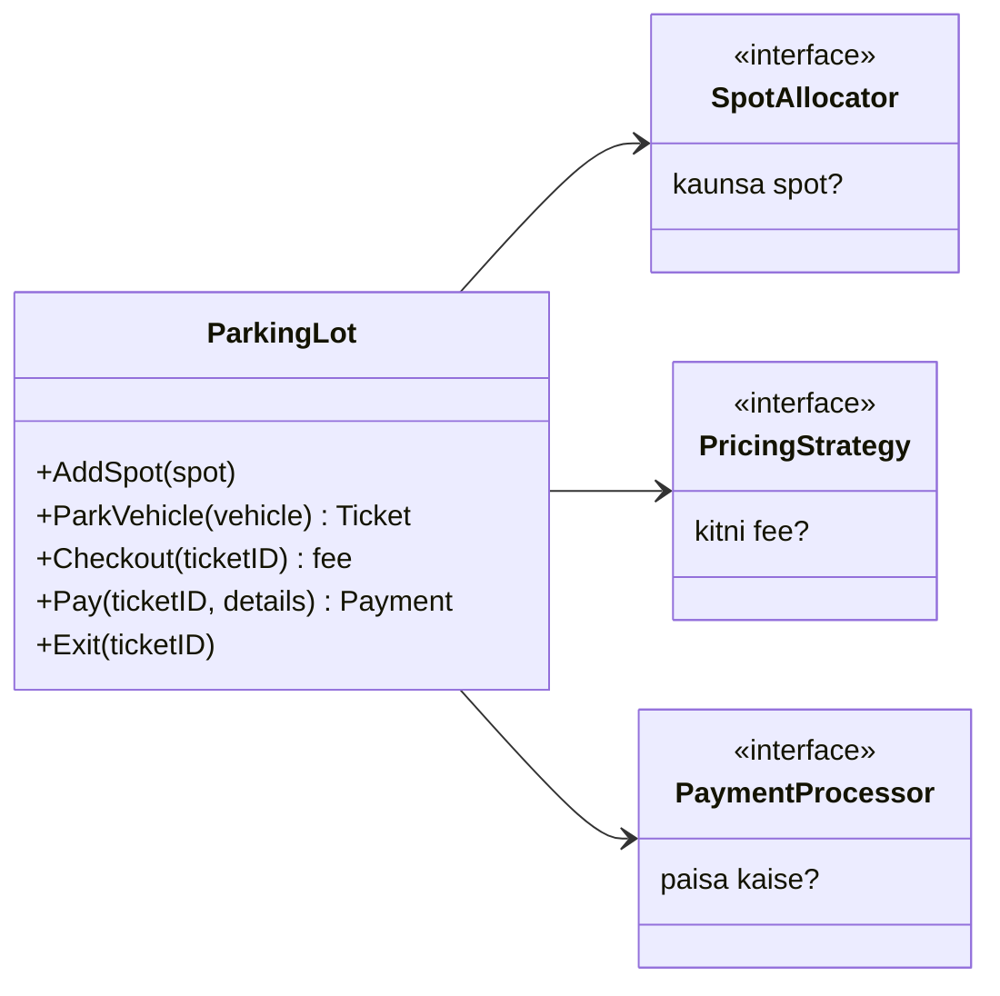
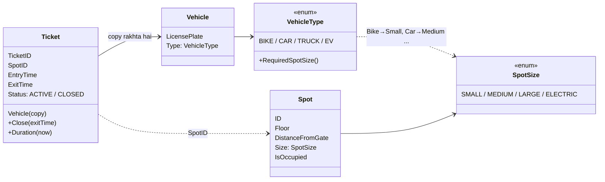
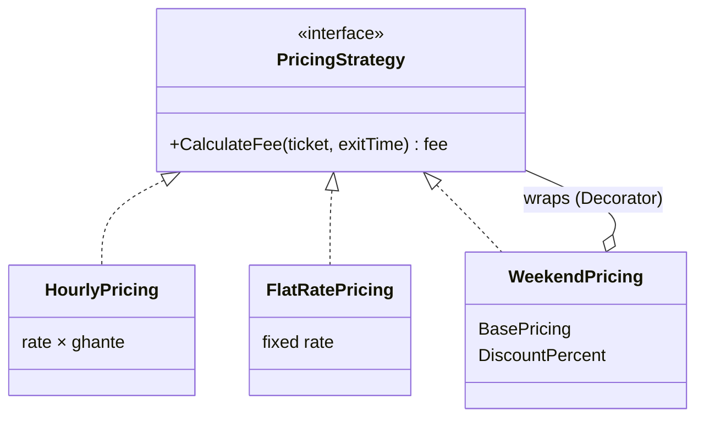
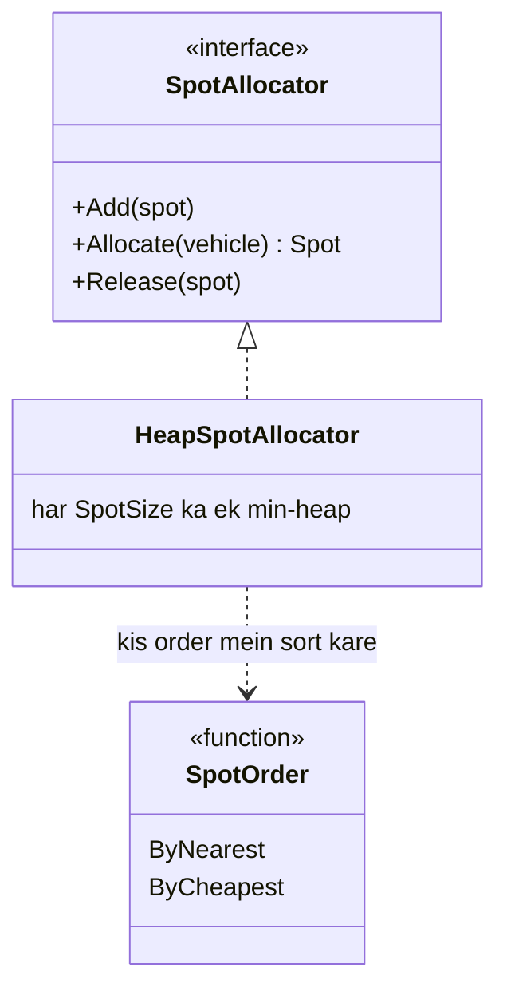
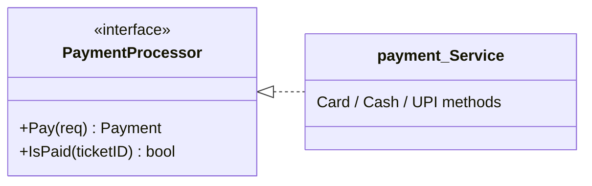
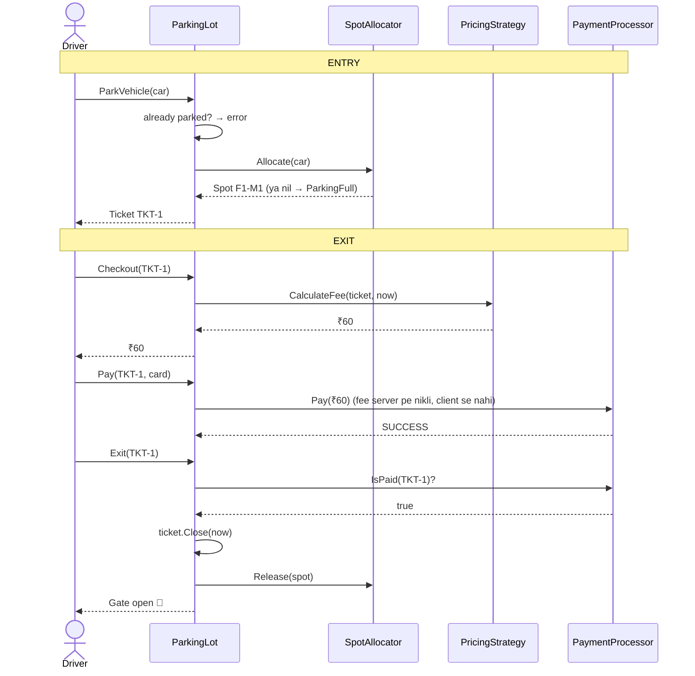

# Parking Lot – LLD (interview version)

> Diagram dekhne ke liye VS Code extension **"Markdown Preview Mermaid Support"** (`bierner.markdown-mermaid`) install karo, phir `Ctrl+Shift+V`.
>
> **Explain karne ka order:** Requirements → Big Picture → Entities → Pluggable parts → Flow → Edge cases.
> Ek baar mein ek hi diagram dikhao, sab ek saath mat dikhao.

---

## Step 0: Requirements (30 sec mein bolo)

- Multiple floors, har floor pe alag size ke spots: **Small, Medium, Large, Electric**
- Vehicles: **Bike, Car, Truck, EV**, aur har vehicle ko apne size ka spot chahiye
- Apna size khaali na ho toh **bada spot** de do (fallback)
- Entry pe **ticket** milta hai, exit pe **fee → payment → exit**
- Pricing badal sakti hai (hourly, flat, weekend discount)
- Ek saath bahut gaadiyan aa sakti hain (**concurrency**)

---

## Step 1: Big Picture (sirf 4 boxes)

> **Bolo:** "ParkingLot ek **coordinator** hai. Spot kaunsa milega, fee kitni lagegi aur payment kaise hoga, ye teen decisions usne khud nahi liye, teen interfaces ko de diye. Isliye kal koi rule badle toh ParkingLot ko chhoona nahi padega."



```
                      ┌──────────────┐
                      │  ParkingLot  │   ← coordinator (sirf flow chalata hai)
                      └──────┬───────┘
          ┌──────────────────┼──────────────────┐
          ▼                  ▼                  ▼
   SpotAllocator      PricingStrategy    PaymentProcessor
   "kaunsa spot?"     "kitni fee?"       "paisa kaise?"
```

**Design principle:** constructor mein teeno bahar se inject hote hain (`NewParkingLot(pricing, allocator, payments)`), isliye ye **DIP** hai.

---

## Step 2: Core Entities (data kya hai)

> **Bolo:** "Teen main cheezein hain: Vehicle, Spot, Ticket. Ticket entry aur exit ko jodta hai."



| Entity | Ek line mein |
|---|---|
| `Vehicle` | Gaadi. Uska `Type` khud batata hai ki kaunsa spot size chahiye (`RequiredSpotSize()`), toh ye rule ek hi jagah hai. |
| `Spot` | Ek parking jagah. Floor aur gate se distance "nearest spot" ke liye hai. |
| `Ticket` | Entry ka saboot. Vehicle ki **copy** rakhta hai, taaki bahar se koi badal na sake. |

**Fallback rule** (`FallbackOrder`):

| Gaadi ko chahiye | Kis order mein dhoondho |
|---|---|
| Small | Small → Medium → Large |
| Medium | Medium → Large |
| Large | Large |
| Electric | Electric → Medium → Large |

---

## Step 3: Pluggable Parts (patterns yahan hain)

> **Bolo:** "Jo cheezein badal sakti hain, unko interface ke peeche rakha hai. Naya rule matlab nayi class, purana code nahi chhoona. Ye **Strategy pattern + OCP** hai."

### 3a. Pricing: Strategy + Decorator



`WeekendPricing` khud fee nahi nikalta. Wo kisi bhi base pricing ko **wrap** karke upar se discount lagata hai, jaise `NewWeekendPricing(NewHourlyPricing(), 20)`. Ise **Decorator** kehte hain.

### 3b. Spot allocation: Strategy (order bhi pluggable)



- **Heap kyun?** Sabse nearest khaali spot `O(log n)` mein milta hai, poori list scan nahi karni padti.
- **Order kyun pluggable hai?** Kal "sabse sasta spot" chahiye toh bas `NewHeapSpotAllocator(ByCheapest)` likhna hai.

### 3c. Payment: alag package, chhota interface



Parking ko payment se sirf **2 kaam** chahiye, isliye interface mein bhi sirf 2 methods hain (**ISP**). Naya method (UPI) add karne pe parking code nahi badalta.

---

## Step 4: Flow (sabse important, yahi story hai)

> **Bolo:** "Gaadi aati hai, spot milta hai, ticket milta hai. Jaate waqt fee dikhti hai, payment hota hai, aur payment ke baad hi spot free hota hai."



---

## Step 5: Edge Cases (interviewer zaroor poochhega)

| Sawaal | Jawab | Code |
|---|---|---|
| Same gaadi do baar park ho jaaye? | `activeVehicles` map check karta hai | `ErrVehicleAlreadyParked` |
| Parking full ho? | Allocator `nil` deta hai | `ErrParkingFull` |
| Bina pay kiye nikle? | `Exit` pehle `IsPaid` check karta hai | `ErrPaymentRequired` |
| Do baar exit / galat ticket? | Ticket active map se delete ho chuka hota hai | `ErrInvalidTicket` |
| 10 gaadiyan ek saath aayein? | `ParkingLot` mein `sync.Mutex`, toh do gaadiyon ko ek spot nahi milega | — |
| Slow bank pe baaki gaadiyan rukengi? | Nahi. Gateway call ke waqt parking ka lock **nahi** pakda hota | `Pay()` |
| Ek ticket pe 10 baar pay dabaya? | Payment service sirf 1 charge karti hai | `ErrAlreadyPaid` |
| Time test kaise karoge? | `nowFunc` inject hota hai, toh test mein time aage jump kar sakte hain | `lot.nowFunc` |

---

## Step 6: Patterns aur SOLID, ek nazar mein

| Kahan | Pattern / Principle |
|---|---|
| `PricingStrategy`, `SpotAllocator`, `ByNearest/ByCheapest` | **Strategy** |
| `WeekendPricing` | **Decorator** |
| `NewParkingLot(...)` mein interfaces inject | **DIP** |
| `PaymentProcessor` (2 methods) | **ISP** |
| `ParkingLot` sirf coordinate karta hai, fee/spot logic nahi | **SRP** |
| Nayi pricing / order / payment method matlab nayi file | **OCP** ✅ |
| Naya vehicle (`Bus`) = `switch` + `FallbackOrder` + `Rates`, **3 jagah edit** | **OCP ❌** (improvement point) |

> 💡 **Interview tip:** last row khud bolo, interviewer ke poochhne se pehle. "Ek weakness hai: naya vehicle type add karne pe 3 jagah badalna padta hai. Isko ek `VehicleConfig` registry bana ke ek jagah la sakta hoon." Isse dikhta hai ki tumhe apne design ki limits pata hain.

---

## Appendix: Deep dive (sirf agar interviewer poochhe)

- `SpotHeap` Go ke `container/heap` ko implement karta hai (`Len/Less/Swap/Push/Pop`), aur `less` function bahar se aata hai.
- `ParkingLot` andar 3 maps rakhta hai: `allSpotsByID` (ID → Spot), `activeTickets` (TicketID → Ticket), `activeVehicles` (plate → TicketID, duplicate check ke liye).
- Pricing rupees mein deti hai, payment **paise** mein leti hai (`fee * 100`), taaki float ka rounding issue na aaye.
